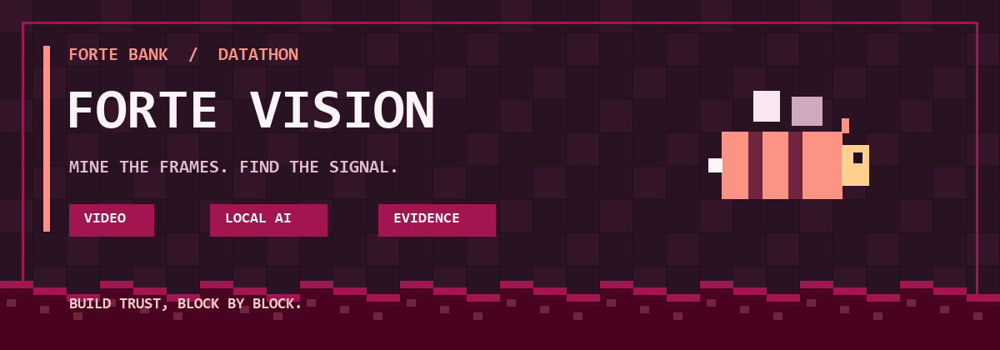
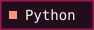
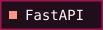
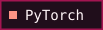
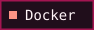
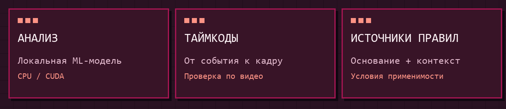
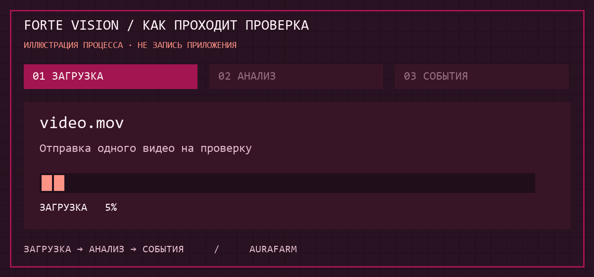

<div align="center">



# Forte Vision

**Видео → события → кадры → проверка человеком**

Поиск визуальных признаков возможных нарушений кассовой дисциплины.<br>
Дататон-проект команды **Aurafarm** для кейса **ForteBank**.

   

[Быстрый старт](#быстрый-старт) · [Возможности](#возможности) · [API](#api) · [Документация](#документация)

</div>

---

## Для жюри · быстрый доступ

> **Начните здесь:** [Запустить проект](#быстрый-старт) · [Проверить API](docs/jury-api.md) · [Оценить модель](ml/weights/reviewed_report.json)
>
> **API после запуска:** [Swagger UI](http://127.0.0.1:8000/docs) · [Health](http://127.0.0.1:8000/health). Это локальные адреса; публичный адрес предоставляется отдельно.
>
> **Отчёты:** [Диагностика dev/test](ml/weights/reviewed_diagnostic_report.json) · [Технические проверки](ml/weights/reviewed_runtime_checks.json). Показатели на обучающих данных не подтверждают качество на новых видео.

## Собираем картину по блокам

Загрузите запись кассовой операции в формате MOV, дождитесь анализа и изучите найденные фрагменты с таймкодами и JPEG-кадрами. Для событий отображаются предполагаемый тип действия, нормативный источник и условия его применения.

Бордовая палитра Forte, блочная эстетика Minecraft и пчёлка-маскот объединяют оформление проекта. В приложении есть анимированный 3D-переход после входа и интерактивный просмотр доказательств. Баннер выше — авторская пиксельная иллюстрация, а не скриншот приложения.

> **Экспериментальный прототип.** Найденное событие требует проверки человеком. Модель не устанавливает факт нарушения; независимое качество текущих весов пока не подтверждено.

## Возможности



| Блок | Что внутри |
| :--- | :--- |
| 🎬 Загрузка | Один `.mov`, прогресс отправки и отслеживание задачи |
| 🧠 Локальный анализ | PyTorch, CPU или CUDA; 16 предполагаемых типов действий |
| 🔎 Доказательства | Таймкоды, 1–3 JPEG-кадра на событие, увеличение и переключение кадров |
| 📖 Контекст правил | Источники, условия применимости и отметки для несопоставленных типов |
| 🐝 Демонстрация | Два сценария: с событиями и без; загрузка видео и модель не нужны |
| 🔐 Доступ | Аккаунты для интерфейса; отдельный API с `X-API-Key` |
| 💾 Сохранение | SQLite для аккаунтов, задач и результатов; ограниченная очередь |

После входа нажмите **«Посмотреть пример»**. Демонстрационные события вымышлены и явно помечены; через API они не возвращаются. Перемотка реального видео по таймкоду зависит от поддержки кодека браузером.

## Быстрый старт

Команды выполняются из корня репозитория. Для Python-запуска нужен **Python 3.12**; для контейнера — запущенный **Docker Desktop / Docker Engine**. Зависимости устанавливаются до автономного инференса.

### Windows · CPU

```powershell
powershell -NoProfile -ExecutionPolicy Bypass -File scripts/setup.ps1 -Cpu
powershell -NoProfile -ExecutionPolicy Bypass -File scripts/run.ps1
```

Для **RTX 5070 / CUDA 12.8** запустите установку без `-Cpu`. Скрипт устанавливает PyTorch 2.7.1 и создаёт `.venv`. `run.ps1` сохраняет случайный `API_KEY` в локальном `.env`, если ключ ещё не задан. `ExecutionPolicy Bypass` действует только в текущем процессе.

### macOS / Linux

```sh
python3.12 -m venv .venv
source .venv/bin/activate
pip install -r requirements-dev.txt
export API_KEY="$(python3 -c 'import secrets; print(secrets.token_urlsafe(32))')"
uvicorn backend.main:create_app --factory --reload
```

| После запуска | Адрес |
| :--- | :--- |
| Приложение / вход | http://127.0.0.1:8000 |
| Swagger UI | http://127.0.0.1:8000/docs |
| Состояние сервера | http://127.0.0.1:8000/health |

Создайте аккаунт через `/register`. Для анализа нужны локальные веса `ml/weights/reviewed_detector.pt` и ML-зависимости. Без доступного анализатора корректное видео получает **HTTP 503**; демонстрация остаётся доступна. `analyzer_configured` в `/health` показывает настройку, а не качество модели.

<details>
<summary><b>Docker · локальный запуск</b></summary>

Создайте `.env` из `.env.example` и заполните `API_KEY` случайным ключом. В macOS/Linux:

```sh
SITE_ADDRESS=http://localhost docker compose -f compose.yaml -f compose.local.yaml up -d --build
```

В PowerShell:

```powershell
$env:SITE_ADDRESS = 'http://localhost'
docker compose -f compose.yaml -f compose.local.yaml up -d --build
```

Приложение: http://localhost:8080 · Swagger: http://localhost:8080/docs. Контейнер использует CPU и сохраняет данные в Docker-томе. Подробнее — в [инструкции развёртывания](docs/deployment.md).

</details>

## Как проходит проверка



**12 секунд: загрузка → анализ → события.** Это анимированная схема, а не запись приложения или реального инференса. Процент загрузки, таймкод и событие вымышлены; длительность анимации не отражает скорость модели. [Статичный кадр](docs/assets/workflow-preview.png).


Модель использует пиксели и временные метки. Звук, имя файла и Excel-разметка не входят во входные признаки. Видео и кадры не отправляются внешним AI-сервисам. Ошибка анализа получает статус `failed` и не подменяется выводом об отсутствии нарушений.

## API

Маршруты жюри требуют `X-API-Key`. Браузер использует отдельные `/app/api/v1/…` с пользовательской сессией; ключ жюри ему не передаётся.

```sh
# Bash: API_KEY должен быть задан в окружении
curl -X POST http://127.0.0.1:8000/api/v1/analyze \
  -H "X-API-Key: $API_KEY" -F "file=@video.mov"

curl http://127.0.0.1:8000/api/v1/jobs/JOB_ID \
  -H "X-API-Key: $API_KEY"
```

Загрузка возвращает **HTTP 202** и `job_id`. Подставьте его вместо `JOB_ID` и опрашивайте задачу: `processing` → `done` или `failed`. Контракт — в [памятке для жюри](docs/jury-api.md), интерактивная схема — в `/docs`.

| Ограничение | По умолчанию |
| :--- | :--- |
| Файл / длительность видео | До 100 МиБ / 600 секунд |
| Общий бюджет запроса | 270 секунд, включая загрузку и очередь |
| Параллельные анализаторы | 1 |
| Активные и ожидающие задачи вместе | 4 |
| Хранение завершённых результатов | 24 часа, не более 200 последних задач |

Недекодируемое видео получает HTTP 415, переполнение — HTTP 429 с `Retry-After`. Настройки и остальные лимиты — в [техническом обзоре](docs/technical-overview.md).

## Что важно знать о модели

Текущие веса обучены на **40 видео**: 21 положительном и 19 отрицательных, с 22 размеченными событиями и 16 типами. Большинство типов представлены одним примером.

 typed F1 на dev/test равен 0,78. Затем развёртываемая модель обучалась на всех 40 видео. Её video F1 = 0,92 и полный event/type F1 = 0,89 измерены **на обучающем наборе** и не являются оценкой качества на новых видео.

`type_confidence` — некалиброванная оценка модели, а не вероятность нарушения. Для восьми типов есть условно применимые публичные основания; остальные требуют контекста или внутренних правил банка. Подробности: [ML-модуль](ml/README.md), [отчёт весов](ml/weights/reviewed_report.json), [диагностический отчёт](ml/weights/reviewed_diagnostic_report.json).

## Карта репозитория

```text
backend/      FastAPI, авторизация, очередь и адаптер модели
frontend/     Интерфейс, пчёлка, 3D-переход и демонстрация
ml/           Инференс, веса, каталог правил и отчёты
scripts/      Установка, запуск и проверка API
tests/        Автоматические проверки
docs/         Инструкции и локальные материалы README
deploy/       Конфигурация HTTPS-прокси Caddy
references/   Сохранённые визуальные референсы
```

После установки dev-зависимостей:

```sh
python -m pytest -q
```

## Документация

| Куда идти | Что найдёте |
| :--- | :--- |
| [Технический обзор](docs/technical-overview.md) | Подробности API, безопасности, лимитов и предыдущих проверок |
| [Развёртывание](docs/deployment.md) | Docker, HTTPS, переменные окружения |
| [Временный внешний доступ](docs/temporary-access.md) | Туннель с локального компьютера |
| [API для жюри](docs/jury-api.md) | Авторизация и работа с задачами |
| [Подключение модели](docs/model-integration.md) | Контракт `ANALYZER_CALLABLE` |
| [ML-документация](ml/README.md) | Модели, инференс и границы оценки |
| [Сторонние компоненты](ml/THIRD_PARTY_NOTICES.md) | Происхождение и лицензии ML-компонентов |

<details>
<summary><b>Если что-то пошло не так</b></summary>

| Симптом | Что проверить |
| :--- | :--- |
| Сервер не стартует без ключа | Запустите `run.ps1` или задайте `API_KEY` в окружении |
| HTTP 503 при анализе | Checkpoint, ML-зависимости и настройку `ANALYZER_CALLABLE` |
| HTTP 415 | Файл должен быть декодируемым MOV и укладываться в лимиты |
| HTTP 429 | Дождитесь освобождения очереди и соблюдайте `Retry-After` |
| CUDA недоступна | Установите с `-Cpu`; на готовом окружении задайте `CASHWATCH_DEVICE=cpu` |
| Видео не перематывается | Проверьте поддержку его кодека браузером |

</details>

### Следующие блоки

- Дополнить редкие типы и провести независимую оценку на новых съёмках.
- Согласовать внутренние правила банка и применимость публичных источников.
- Проверить переносимую автономную поставку и постоянный HTTPS на сервере.

---

<div align="center">

**Aurafarm · Forte Vision**<br>
*Строим доверие, блок за блоком.*

<sub>Визуальная стилизация для дататон-проекта. Minecraft — источник эстетического вдохновения; проект не заявляет связи с Mojang или Microsoft.</sub>

</div>
